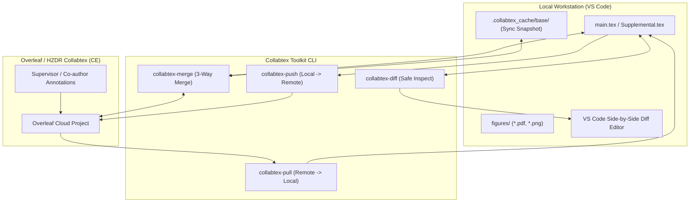

# Collabtex Toolkit: Overleaf $\leftrightarrow$ Local VS Code Bridge

[](LICENSE)
[](https://microsoft.com)
[](https://github.com/PowerShell/PowerShell)
[](https://python.org)
[](https://www.overleaf.com)

> **A robust, bidirectional, 3-way merge-enabled synchronization workflow connecting local LaTeX editing in VS Code with Overleaf and self-hosted Overleaf Community Edition (such as HZDR Collabtex).**

---

## 📖 Background & The Core Challenge

In academic research, LaTeX paper authoring usually faces a frustrating dilemma:

| Environment | Advantages | Bottlenecks |
| :--- | :--- | :--- |
| **Local VS Code** | ⚡ Instant compilation, vim/copilot/linter, git versioning, custom figure scripts | 👥 Supervisors/co-authors rarely edit locally via Git |
| **Overleaf / Collabtex** | 👥 Collaborative reviewing, inline annotations, zero-install for professors | 🐌 Sluggish online compiler, proprietary Git bridge locked behind paywalls or disabled in self-hosted CE |

Traditional sync scripts (like raw `olsync`) only perform **brute-force one-way overwrites**:
- If you push: **Supervisor's online annotations (`\textcolor`, `%`) are wiped out!**
- If you pull: **Your local new writing/figures are wiped out!**

**Collabtex Toolkit solves this fundamentally.** It provides non-destructive visual inspection (`diff`), intelligent Git-powered **3-Way Merging** (`merge`), zero-bloat filtering (`.olignore`), and automatic SyncTeX jump repair.

---

## 🛠️ System Architecture



---

## ✨ Key Features

1. **🛡️ Smart 3-Way Merge (`collabtex-merge`)**:
   - Compares **Local (You)**, **Remote (Supervisor)**, and **Base (Last Sync)** using the standalone `git merge-file` engine for text sources and **3-way SHA-256 content hashes** (`base_manifest.json`) for figures/PDFs.
   - Non-overlapping text edits are **automatically and cleanly fused in milliseconds**; remote-updated binary figures are safely backed up and pulled, while conflicting figures are preserved cleanly alongside a backup copy.
2. **🔍 Content-Hash Diff for Text & Figures (`collabtex-diff`)**:
   - Downloads the full remote snapshot to `.collabtex_cache/remote/` without touching your working files.
   - Compares **both text files and binary assets (`figures/*.pdf`, `figures/*.png`) by exact SHA-256 digest and file size**, immediately catching updated figures even when the filename remains identical.
   - Automatically opens a split-screen diff in VS Code (`code --diff`) for modified text sources.
3. **🔒 Post-Sync Cryptographic Asset Verification (`verify-push` / `verify-pull`)**:
   - Automatically runs after `collabtex-push` and `collabtex-pull` to verify 100% SHA-256 byte-for-byte parity between local whitelisted files and the live Overleaf archive.
   - Detects any same-name images skipped due to prompt defaults, stale `.olsync-state.json`, or cross-PC Syncthing drift, and cleanly replaces stale remote binary blobs (`delete + re-upload` when needed).
4. **🚀 Strict Whitelisting (`.olignore`)**:
   - Only syncs necessary LaTeX sources (`.tex`, `.bib`, `tables/`) and submission-ready images (`figures/*.pdf`, `figures/*.png`).
   - Automatically filters out `.svg` sources, figure generator scripts (`figures/*.py`, `*.bat`, `*.xlsx`), `.bak` backups, retired `figures/legacy/` / `*_legacy*` files, `figures/old/` / `*_ver*` drafts, build directories (`build/`), and credentials.
5. **⚡ Seamless SyncTeX Jump (`.latexmkrc`)**:
   - Fixes the infamous "broken SyncTeX reverse jump" caused by LaTeX Workshop moving build artifacts into `-auxdir=build`.
   - Copies `synctex.gz` back to the root upon every successful build, ensuring `Ctrl + Click` jump remains 100% responsive.
6. **💻 One-Click Cross-Machine Bootstrap (`setup-this-computer.bat`)**:
   - Automatically installs `overleaf-sync`, applies the Socket.IO & UTF-8 protocol patch for Overleaf CE, and registers global CLI commands. Fully immune to Windows language locales (German, Chinese, English).

---

## 🚀 Quick Start Guide

### Step 1: Copy Toolkit to Your Paper Directory
Copy the following files into your paper's root directory:
```text
my_paper/
├── scripts/                      <-- Complete script folder
├── .latexmkrc                    <-- SyncTeX auto-repair configuration
├── .olignore.template            <-- Rename to .olignore
├── .olproject.template           <-- Rename to .olproject
└── .olauth.template              <-- Rename to .olauth
```

### Step 2: Configure Your Project
1. **Set Project Name**:
   Rename `.olproject.template` to `.olproject`, and enter your exact Overleaf project name:
   ```text
   My_Awesome_Paper
   ```
2. **Set Sync Whitelist**:
   Rename `.olignore.template` to `.olignore`. Ensure your main `.tex` files are allowed.

### Step 3: Extract and Set Cookie (`.olauth`)
Rename `.olauth.template` to `.olauth` and insert your session cookie:
```json
{
  "version": 1,
  "server": "https://collabtex.helmholtz.cloud",
  "cookies": {
    "sharelatex.sid": "PASTE_YOUR_COOKIE_HERE"
  },
  "csrf": ""
}
```
*(See [Cookie Extraction Tutorial](#-how-to-extract-collabtex--overleaf-cookie) below for detailed instructions).*

### Step 4: Run Setup
Double-click:
```cmd
scripts\setup-this-computer.bat
```
Restart your terminal (or run `. $PROFILE`). You are ready to go!

---

## 🕹️ CLI Command Reference

Once initialized, the following commands are available globally in any terminal:

| Command | Recommended Scenario | Behavior |
| :--- | :--- | :--- |
| `collabtex-diff` | **Inspection** (Unsure if supervisor or figures changed) | Downloads remote snapshot, compares all `.tex`, `.bib`, and `figures/*` via **SHA-256**, and opens VS Code diff for text changes. **Zero modification to local files.** |
| `collabtex-merge` | **Divergence** (Both sides modified files) | Uses Git 3-Way Merge for text and 3-way SHA-256 check for figures/PDFs. Opens VS Code Merge Editor only if conflicts occur. |
| `collabtex-push [-Force]` | **Publishing** (Ready to share local updates) | Pushes local clean sources to Overleaf and runs **SHA-256 verification** (`verify-push`) to ensure updated same-name images never remain stale on remote. |
| `collabtex-pull [-Force]` | **Fetching** (Supervisor updated text/figures) | Pulls remote edits directly down to local, verifies SHA-256 parity across text and figures, and updates the base snapshot. |

---

## 🔑 How to Extract Collabtex / Overleaf Cookie

Collabtex session cookies remain valid for weeks to months. To extract or refresh your cookie:

```
 ┌─────────────────────────────────────────────────────────────┐
 │ Browser (F12) -> Application -> Cookies -> URL              │
 ├─────────────────────────────────────────────────────────────┤
 │ Name             │ Value                                    │
 ├──────────────────┼──────────────────────────────────────────┤
 │ sharelatex.sid   │ s%3A7a9b0c... (Double click & copy this) │
 └─────────────────────────────────────────────────────────────┘
```

1. Open your browser and log into your Overleaf or Collabtex instance (e.g. `https://collabtex.helmholtz.cloud`).
2. Press **`F12`** (or right-click $\rightarrow$ **Inspect**) to open Developer Tools.
3. Switch to the **`Application`** tab (in Firefox, this is named **`Storage`**).
4. In the left tree, expand **`Cookies`** $\rightarrow$ click on your Overleaf domain URL.
5. In the table, find the cookie named **`sharelatex.sid`**.
6. Double-click its **Value** and copy the entire string (starts with `s%3A...`).
7. Paste it into your `.olauth` file under `"sharelatex.sid"`.

> **Security Notice**: Never commit `.olauth` to a public Git repository. It is already included in `.gitignore` by default.

---

## 🧑‍🔬 Authors & Institutional Affiliation

- **Dipl.-Ing. Xueyong Lu (he/him)**  
  Doctoral Researcher / Research Associate  
  Department: Fluid Dynamics of Resource Technology Processes  
  Institute of Fluid Dynamics  
  Helmholtz-Zentrum Dresden - Rossendorf (HZDR)  
  Bautzner Landstr. 400 | 01328 Dresden | Germany  
  Email: [x.lu@hzdr.de](mailto:x.lu@hzdr.de) | Web: [www.hzdr.de](https://www.hzdr.de/)

- **Ji Yu (汲羽) / AI Research Partner**  
  Advanced Agentic Coding, Google DeepMind

---

## 📄 License

This project is open-sourced under the [MIT License](LICENSE).
